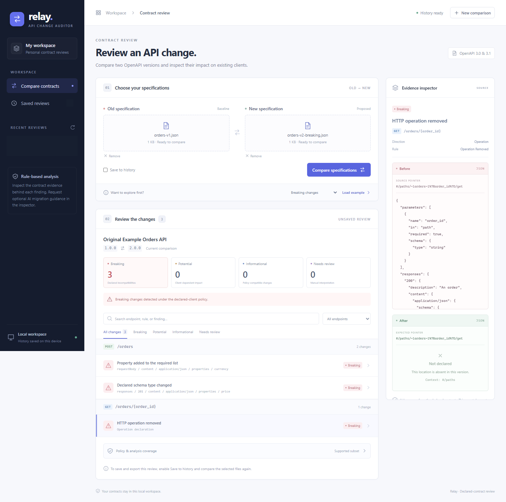
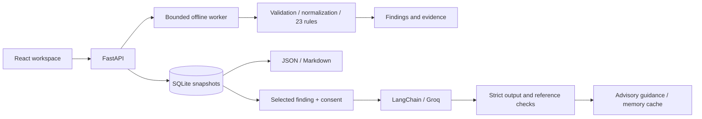

# Relay - API Change Impact Auditor

Compare OpenAPI versions, inspect compatibility findings with exact source evidence, and optionally request LangChain migration guidance.

**Python / FastAPI / React / LangChain / SQLite** - verified locally on Windows x64 with Python 3.12. Version **0.7.0**. [GitHub source](https://github.com/AryamanAnand123/relay-api-change-auditor). The full application runs locally; no public backend is deployed.



## What it does

- Compares OpenAPI 3.0.x/3.1.x JSON using **23 deterministic rules**, with breaking, potential, informational, and manual-review classifications.
- Shows endpoint groups, search/filter controls, and before/after evidence with source JSON Pointers.
- Saves immutable SQLite snapshots, reuses duplicates, reopens history, and exports JSON/Markdown reports.
- Adds optional LangChain/Groq explanations with consent, structured validation, evidence binding, timeouts, and caching.
- Preserves useful rule results when AI is missing, rate-limited, invalid, or unavailable.

The rule engine owns severity. AI guidance is advisory and can make assumptions beyond the evidence. [Scope and limitations](docs/limitations.md).

## Try the original examples

Open the running [local workspace](http://127.0.0.1:8010/), load an example, and compare. Uncheck **Save to history** for a demo that leaves no record.

| Example | Expected result | Inspect without running the app |
| --- | --- | --- |
| Breaking changes | 3 breaking findings | [Report](examples/reports/orders-breaking.md) |
| Additive changes | 2 informational findings | [Report](examples/reports/orders-additive.md) |
| Identical versions | 0 findings in the supported subset | [Report](examples/reports/orders-identical.md) |

The examples are original synthetic contracts. Reports are clearly labelled recorded offline examples, not live user history. [Two-minute demo and screenshots](docs/demo.md).

## Run locally

Prerequisites: Python 3.12, Node 22.12+ (tested with 22.14.0/npm 10.9.2), and Git. No paid service, Docker, database server, or model download is required. From a fresh checkout in PowerShell:

```powershell
py -3.12 -m venv .venv
.\.venv\Scripts\python.exe -m pip --isolated install --index-url https://pypi.org/simple --only-binary=:all: --require-hashes -r backend\requirements.lock.txt
.\.venv\Scripts\python.exe scripts\setup-history.py
Push-Location frontend
npm.cmd ci
npm.cmd run build
Pop-Location
.\.venv\Scripts\python.exe -m uvicorn auditor.main:app --app-dir backend --host 127.0.0.1 --port 8010 --no-proxy-headers
```

Open **http://127.0.0.1:8010/**. On this machine, the environment and history are already initialized; start the existing environment instead of recreating it. The 66-package hashed Python lock targets Windows x64/Python 3.12. Full setup, storage, API usage, and troubleshooting commands are in the [local development guide](docs/local-development.md).

Optional AI: create a Groq **Free-plan** key and enter it through `.\.venv\Scripts\python.exe scripts\configure-ai.py`. Do not paste the key into chat or source. It stays in the account-protected runtime folder outside Git and OneDrive. Deterministic comparison works without a key. [AI setup and data boundaries](docs/local-development.md#enable-free-hosted-ai-guidance).

## Architecture



[Design decisions and trust boundaries](docs/architecture.md) - [Rule catalog and policy](docs/comparison-policy.md).

## Verified results

| Measurement | Evidence |
| --- | --- |
| Frozen evaluation | 90/90 cases: 76 comparisons and 14 rejections; all 23 rules represented |
| Findings/evidence | 56 expected signatures matched; 112 evidence sides checked |
| Compatible controls | 0 breaking false positives across 26 authored controls |
| Backend regression suite | 375 tests passed, including release exclusions and report reproduction |
| Local worker latency | About 749 ms p50 / 928 ms p95 across 12 retained samples, including startup |
| Separate AI evaluation | 5/6 first attempts generated; agent review rated 1 grounded, 4 partially grounded, 1 not generated |

These are internal authored evaluation results, not general API/model accuracy or a deployment SLA. Baseline failures, a specification-grounded label correction, and the rejected AI attempt are preserved. [Methodology and full results](docs/section-6-review.md).

```powershell
.\.venv\Scripts\python.exe -m pytest -q -p no:cacheprovider
.\.venv\Scripts\python.exe -m pip check
# With the backend running:
.\.venv\Scripts\python.exe scripts\check-section-6.py
```

Browser checks use installed Chrome/Edge. Model-free commands, opt-in real AI checks, and fresh-output evaluation commands are documented in the [development guide](docs/local-development.md) and [evaluation guide](evaluation/README.md).

## Portfolio and hosting

[Resume entry and interview notes](docs/portfolio.md) - [LaTeX snippet](docs/resume-project.tex) - [Publication proposal](docs/publication-plan.md) - [Free hosting review](docs/hosting-decision.md).

Recommended first publication: a public source repository with screenshots, recorded original-example reports, and the complete local app. The current app is a single-user loopback workspace. Shared public history, public upload handling, durable cloud storage, and server-key abuse controls need a separate hosting implementation. A static host cannot run the existing FastAPI backend.

Public source repository: [AryamanAnand123/relay-api-change-auditor](https://github.com/AryamanAnand123/relay-api-change-auditor). No open-source license has been selected. The completed Cedar project remains separate.

[Section-by-section plan](PLAN.md) - [Section 7 review](docs/section-7-review.md).
