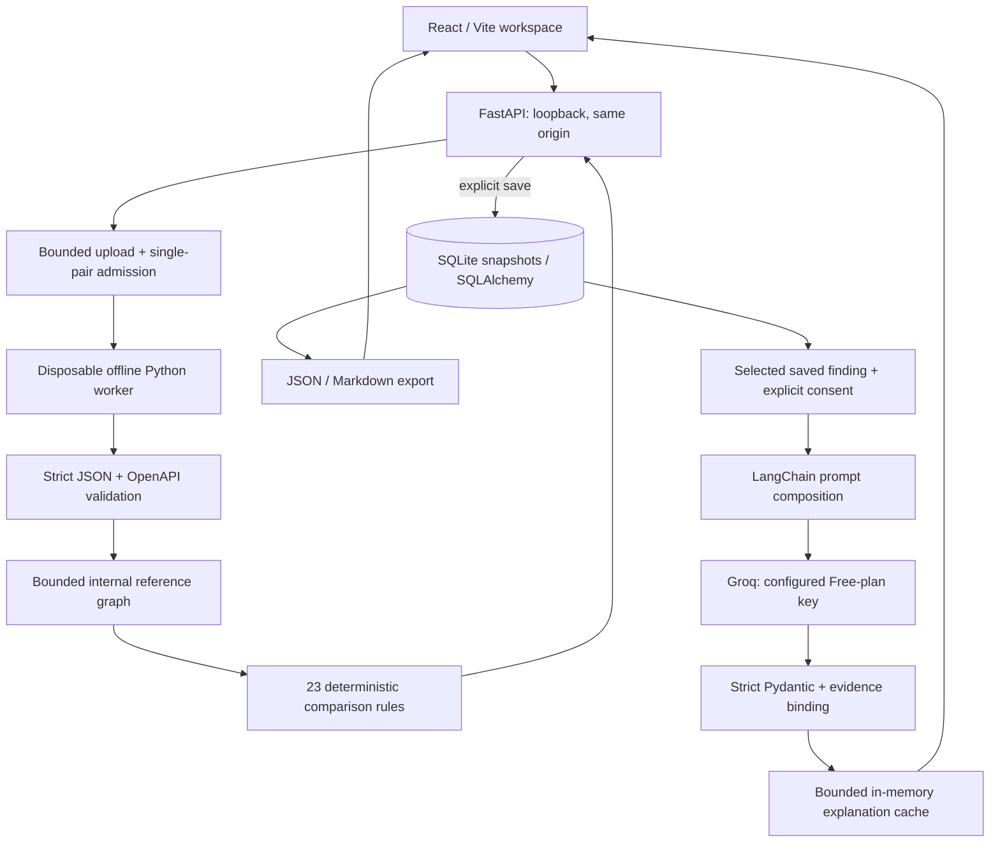

# Architecture and design decisions

Relay compares declared API contracts and shows source evidence. The deterministic engine owns findings and severity; LangChain provides optional advisory migration prose.

## Request lifecycle

1. The browser sends old/new JSON files to the same-origin backend. The upload boundary checks origin, compression, bytes, elapsed upload time, and single-pair admission before parsing.
2. A disposable subprocess validates and normalizes the pair with a ten-second budget. References stay within the input document, and network connects are disabled in the worker. Invalid or over-budget inputs fail explicitly.
3. The comparator matches exact method/path operations and evaluates the declared-client policy. Findings include stable logical IDs, direction, rule, severity, source pointers, before/after values, engine/policy versions, and coverage gaps.
4. Stateless comparison returns without persistence. Explicit saving creates an immutable SQLite snapshot in a transaction; identical canonical snapshots reuse an existing record. History pagination returns metadata until a specific report is opened.
5. Exports use the stored snapshot, keeping evidence consistent across reopening and downloads. Deletion removes the row and its payload and evicts related explanation cache entries.
6. An optional explanation request reloads a saved finding. The server minimizes context, gives the selected finding the request-local alias `F1`, and invokes LangChain ChatGroq without tools. Local validation checks schema, lengths, alias, and reference keys before mapping back to the real finding ID.

## Why these choices

| Choice | Reason and tradeoff |
| --- | --- |
| Deterministic findings before AI | Reproducible severity and evidence remain useful when a model fails; coverage is limited to implemented rules. |
| Offline disposable worker | Bounds runtime and keeps reference retrieval out of analysis; startup adds roughly a second to small local requests. |
| One backend origin | Simplifies the local browser flow and key isolation; current origin/Host rules intentionally target loopback. |
| SQLite + SQLAlchemy/Alembic | Small single-user setup with atomic quotas and migrations; shared cloud history would require authentication, isolation, and durable storage. |
| Saved evidence instead of original bytes | Retains reproducible findings without retaining original uploaded files; normalized snapshots still contain contract details. |
| Fixed LangChain workflow | Prompt composition and structured provider integration are sufficient; no autonomous agent or retrieval is required. |
| One AI attempt and bounded cache | Limits accidental quota use and exposes failures; prose can still make unsupported assumptions despite valid JSON. |

The implementation uses one API process. It does not use Redis, PostgreSQL, vector search, LangGraph, Docker, or client-code tracing. These are not necessary for the current scope.

## Trust and data boundaries

Uploaded descriptions and model prose are untrusted text. React escapes rendered strings, while CSP restricts assets and connections. Provider keys remain server-side in the account-protected runtime folder. LangSmith tracing is disabled. Application logs omit uploaded bodies, provider output bodies, and keys.

Default limits include 2 MiB per input, 64 nesting depth, 20,000 parsed nodes, 300 operations, 500 findings, and an 8 MiB result. History defaults to 100 snapshots and 64 MiB of logical result JSON. AI permits one concurrent attempt, four/minute, 50/day per process, and a 25-second deadline. These are local development controls, not a multi-user abuse or billing system.

See [comparison policy](comparison-policy.md), [input review](section-1-review.md), [retention](section-3-review.md), [AI boundaries](section-5-review.md), and [evaluation](section-6-review.md). No finding is a certification of complete schema or runtime compatibility.
