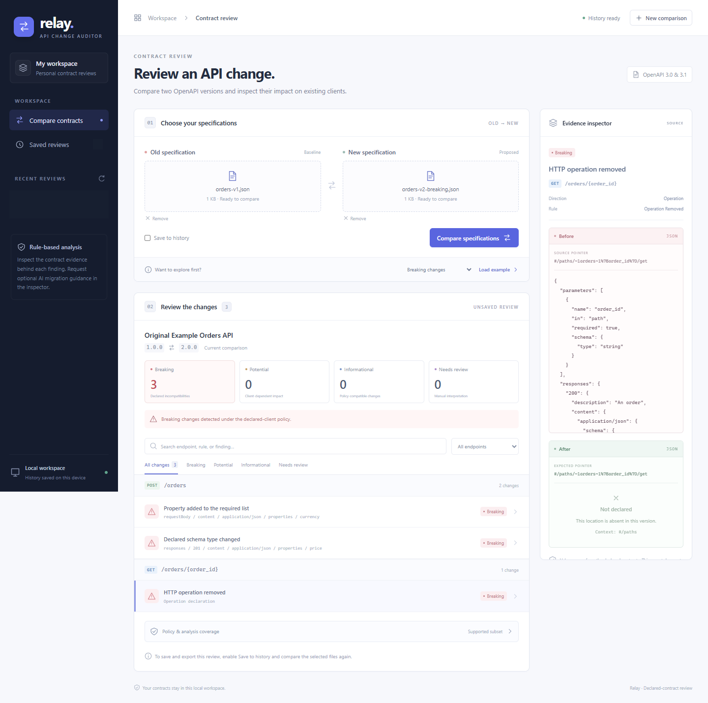

# Reproducible demo

The three original orders examples exercise actual deterministic analysis. They contain no customer data, and declared endpoints are never called. The browser demo does not need a Groq key. Screenshots show the real application; AI screenshots retained from Section 5 are labelled separately below.

## Two-minute walkthrough

Start the application using the [local setup guide](local-development.md), then open **http://127.0.0.1:8010/**.

1. Choose **Breaking changes** in the example selector and click **Load example**. Uncheck **Save to history** for a demo that leaves no record, then compare.
2. Observe **three breaking findings**: removed GET order operation, newly required request `currency`, and response `price` changing from number to object.
3. Select a finding. Show its direction, rule, source JSON Pointers, and before/after values. Search for `schema_type_changed`, then clear the search. Open **Policy & analysis coverage** to explain the client assumptions and supported subset.
4. Click **New comparison**, load **Additive changes**, leave saving unchecked, and compare. Observe **two informational findings** and no breaking findings. This is limited to the documented policy.
5. Repeat with **Identical versions**. There are zero findings, with the same explicit coverage limits.
6. On mobile, use **Specifications**, **Findings**, and **Evidence** tabs; selecting a finding opens its evidence.

For a separate saved-history demonstration, enable saving, compare an original example, reopen it from **Saved reviews**, export JSON/Markdown, and confirm deletion when finished. Only delete records you created for the demo. Duplicate comparisons reuse an existing record, so do not assume an existing example report belongs to a new demo.

## Recorded original-example reports

| Example | Expected findings | Reports |
| --- | --- | --- |
| Breaking | 3 breaking | [JSON](../examples/reports/orders-breaking.json), [Markdown](../examples/reports/orders-breaking.md) |
| Additive | 2 informational | [JSON](../examples/reports/orders-additive.json), [Markdown](../examples/reports/orders-additive.md) |
| Identical | 0 findings | [JSON](../examples/reports/orders-identical.json), [Markdown](../examples/reports/orders-identical.md) |

These reports are explicitly labelled public offline examples, not saved user comparisons. Reproduce their exact bytes with:

```powershell
.\.venv\Scripts\python.exe scripts\build-demo-reports.py
```

The generator uses the same validator, comparator, and exporters as the app, without accessing history or credentials. [The report manifest](../examples/reports/manifest.json) records output hashes and engine/policy versions.

## Screenshots



[Mobile findings](images/relay-mobile.png) · [Mobile source evidence](images/relay-evidence.png)

The fresh screenshots use unsaved original examples. Any preexisting recent-history metadata is masked. The screenshot/browser check calls the real backend and verifies that saved-row count and AI usage remain unchanged.

[Earlier real AI guidance](section-5-guidance.png) and [mobile AI guidance](section-5-mobile.png) show an actual Section 5 model response, not a live call made for this screenshot run. They are historical evidence and remain subject to the [AI evaluation limitations](section-6-review.md).

To recreate the current screenshot walkthrough with the server running and Chrome/Edge installed:

```powershell
Push-Location frontend
npm.cmd run test:portfolio
Pop-Location
```

## Optional live AI segment

Configure a project Free-plan key using `scripts/configure-ai.py`. Save a comparison, select a supported finding, scroll to **AI migration guidance**, confirm evidence sharing, and click **Explain finding**. Explain the model provenance and cache label, then check every suggestion against the actual contract. A failed model call leaves rule findings and exports usable. This optional segment consumes free-provider quota; it is not run automatically by the portfolio demo.
