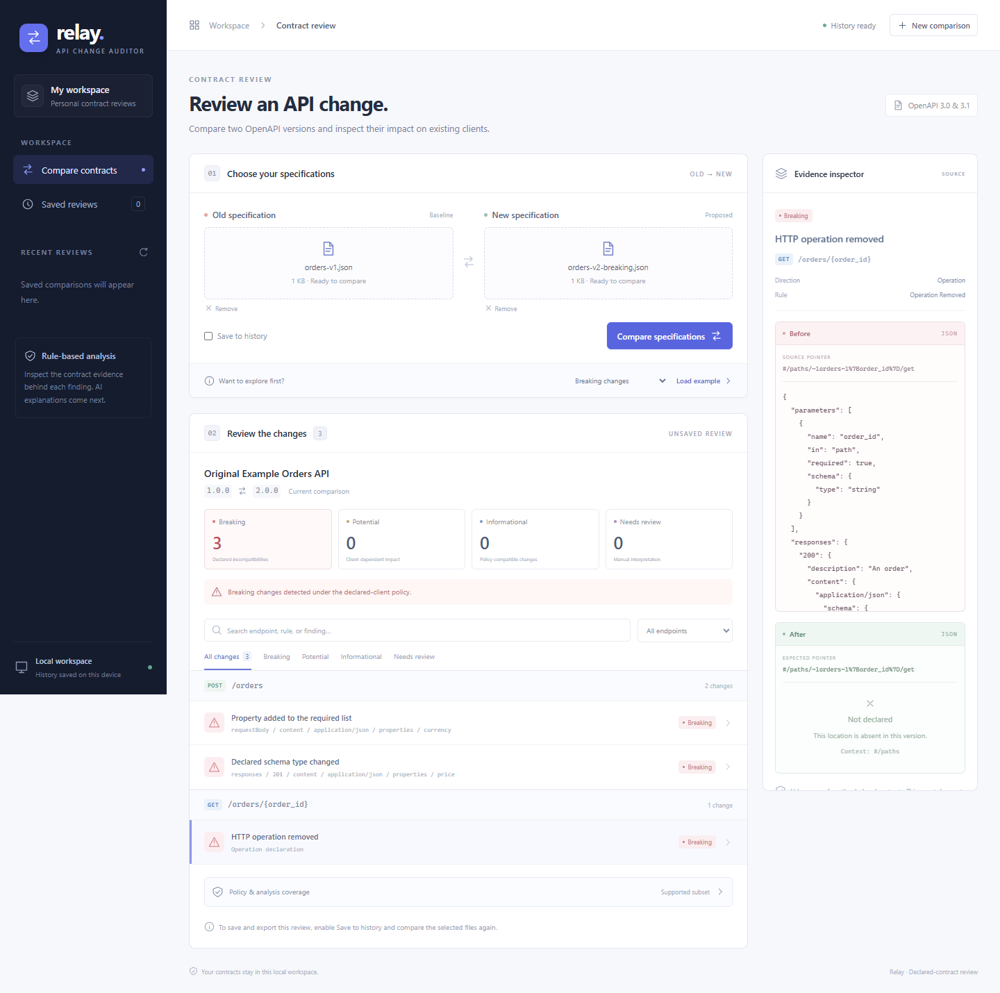

# Local development and verification

Compare two OpenAPI documents, inspect supported compatibility findings, and use LangChain to explain migration work. Built one tested, reviewed section at a time. See [the full plan](../PLAN.md).

## Current status: Section 6 — evaluation and reliability

Relay provides a React workspace for uploading OpenAPI JSON, comparing versions, filtering findings, and inspecting before/after evidence. Save reviews to SQLite, reopen them, export JSON/Markdown, or delete them with confirmation. Optionally request LangChain/Groq migration guidance using a hosted Free-plan key. Deterministic analysis works without an account or key. A frozen 90-case corpus and production-worker checks now measure behavior and limits. No paid service, database server, or hosting is required. See the [Section 6 review](section-6-review.md) and [comparison policy](comparison-policy.md).



This project is separate from Cedar. Development uses port **8010**, not Cedar's 8000. No Cedar database, environment, or settings are modified.

All commands in this guide run from the project root (the folder containing `backend` and `frontend`), not from `docs`.

## Setup

From the project root in PowerShell, on a fresh checkout:

```powershell
py -3.12 -m venv .venv
.\.venv\Scripts\python.exe -m pip --isolated install --index-url https://pypi.org/simple --only-binary=:all: --require-hashes -r backend\requirements.lock.txt
.\.venv\Scripts\python.exe -m pip check
.\.venv\Scripts\python.exe scripts\setup-history.py
```

Use the existing `.venv` on this machine; do not recreate it just to start. No environment activation is needed. The cumulative lockfile covers 66 packages; download reports retain artifact URLs and hashes. It targets Windows x64 / CPython 3.12. History is already initialized on this machine; the setup script is idempotent, applies migrations, and refuses to initialize an unrelated nonempty directory. Section 5 adds 22 hashed wheels, including langchain-core 1.7.6, langchain-groq 1.1.3, and groq 0.37.1. No model is downloaded.

Build the frontend once using Node 22.12+ (tested with 22.14.0/npm 10.9.2):

```powershell
Push-Location frontend
npm.cmd ci
npm.cmd run build
Pop-Location
```

The checked-in lockfile pins package versions and integrity hashes from the official npm registry. Project npm settings disable dependency lifecycle scripts. React/React DOM 19.3.1, Vite 8.3.6, and playwright-core 1.65.0 are pinned; no new Python packages were needed for this section. No browser is downloaded: checks use installed Chrome/Edge. See [download provenance](section-4-downloads.json). FastAPI serves the built files, so Node is needed for building/checking, not for running the built app. During frontend development, run `npm.cmd run watch` from `frontend`, then reload the browser after a rebuild.

## Start

```powershell
powershell.exe -NoProfile -ExecutionPolicy Bypass -File .\scripts\start-backend.ps1
```

This process-only policy exception does not change persistent PowerShell settings. Alternatively:

```powershell
.\.venv\Scripts\python.exe -m uvicorn auditor.main:app --app-dir backend --host 127.0.0.1 --port 8010 --no-proxy-headers
```

Open http://127.0.0.1:8010/ for the browser workspace. `/api/system` provides backend diagnostics and `/health` reports `{"status":"ok","section":7,"version":"0.7.0"}`. `/api/system/database` checks history readiness; `/api/ai/status` reports configuration without making a provider call or exposing a key. A missing frontend build produces an actionable 503 at `/`; API routes still work. A missing history database does not disable stateless comparison; saved-history routes return 503 until initialized. `/openapi.json` describes the endpoints; interactive API docs are not enabled yet. Use one API process: validation, comparison, and saving share one upload admission limit. Stop the server with Ctrl+C in its terminal.

## Use the browser workspace

1. Load an original example, or choose/drop an old and new `.json` specification, up to 2 MiB each.
2. Leave **Save to history** checked to retain the result, or uncheck it for stateless analysis. If history is unavailable, comparison remains available without saving.
3. Compare, then filter by severity, endpoint, or search text. Select a finding to inspect its rule, direction, JSON Pointers, and before/after values. Open **Policy & analysis coverage** to read assumptions and unsupported semantics.
4. For saved reviews, export JSON/Markdown, reopen from **Saved reviews**, or confirm deletion. Reloading a saved review's `#review=UUID` URL reopens its snapshot. Unsaved reviews must be compared with saving enabled before export.

Mobile layouts separate Specifications, Findings, and Evidence into keyboard-accessible tabs. Long evidence previews are clipped at 20,000 characters with a notice; saved server exports retain the full bounded report. Browser storage is unused; saved data resides in the backend database. All page assets and browser API requests use the same origin, with no external fonts or images. Optional provider calls happen only from the backend after an explicit explanation request.

## Enable free hosted AI guidance

Use a Groq **Free-plan** account and create a key at [Groq API Keys](https://console.groq.com/keys). Stay on the Free plan; no billing/card or upgrade is needed for this project. The application cannot inspect your account's billing plan. Groq documents free quotas and requires a payment method to upgrade to its paid tier: [rate limits](https://console.groq.com/docs/rate-limits), [billing](https://console.groq.com/docs/billing-faqs).

Run this in an interactive local terminal from the project folder:

```powershell
.\.venv\Scripts\python.exe scripts\configure-ai.py
```

Confirm the Free plan and enter the key at the hidden prompt. The script stores it as a plaintext server credential at `%LOCALAPPDATA%\ApiChangeAuditor\groq.key`, in the account-protected runtime folder outside Git and OneDrive. Do not paste it into chat, source, frontend settings, or command arguments. Reload the workspace; no restart is needed after key replacement. To disable AI, set `API_AUDITOR_AI_ENABLED=false` and restart the backend.

Save a comparison, select a supported finding, and scroll down in the evidence inspector to **AI migration guidance**. Check the evidence-sharing box, then click **Explain finding**. The backend sends bounded endpoint/field names, pointers, selected contract values, and policy context to Groq. It excludes descriptions, examples, original documents, and client code. Groq's [data policy](https://console.groq.com/docs/your-data) explains retention exceptions and controls; avoid sending private contracts without appropriate permission.

LangChain composes the prompt and calls ChatGroq with native structured output using `openai/gpt-oss-120b`. Local strict Pydantic validation and evidence-binding checks run before guidance is accepted. No tools, URL retrieval, patch execution, or LangSmith tracing are enabled. Each request makes at most one provider attempt, has a 25-second total budget, and has no automatic retry or model fallback. This process permits one concurrent request, four attempts/minute, and 50/day by default. Local counters reset on restart and are development guards, not billing controls; Free-plan eligibility and quotas remain provider controlled.

Successful guidance is cached in backend memory for one hour, at most 100 entries. Cache keys include the saved snapshot/input hashes, finding, engine/policy, prompt text/version, provider, and requested model. Deleting the saved comparison evicts its entries; restart also clears them. AI is advisory and separate from immutable comparison exports. The pilot found correct core change summaries but some unsupported migration/test assumptions; review each suggestion against the full contract. A valid response is not proof of factual correctness.

## Compare the examples

From the project root, with the server running:

```powershell
curl.exe -sS -F "old=@examples/orders-v1.json;type=application/json" -F "new=@examples/orders-v2-breaking.json;type=application/json" http://127.0.0.1:8010/api/specifications/compare
```

The response has `status: compared`, `comparison_performed: true`, a `comparison` report, and normalized `old`/`new` models. The original breaking example produces **three breaking findings**: removed GET operation, newly required request currency, and changed response price type. Use `orders-v2-compatible.json` instead for two informational findings: optional request note and a new endpoint. Compatibility is conditional on the declared-client policy; no result certifies an upgrade as universally safe.

For validation without comparison, send the same fields to `/api/specifications/validate`; it still returns `status: validated` and `comparison_performed: false`. Both specification routes remain stateless and create no history records.

## Save, reopen, export, and delete

```powershell
# Explicitly save a completed comparison:
curl.exe -sS -F "old=@examples/orders-v1.json;type=application/json" -F "new=@examples/orders-v2-breaking.json;type=application/json" http://127.0.0.1:8010/api/comparisons
Invoke-RestMethod http://127.0.0.1:8010/api/comparisons
```

The save response contains a UUID `id`, snapshot metadata, and `result`. A new snapshot returns 201; a duplicate canonical snapshot returns 200 with `reused: true`. Saving a duplicate does not consume another history slot. History lists metadata only, with `limit` 1-50 and an optional UUID `cursor`.

Replace `YOUR_RUN_ID` below with the returned UUID. Export commands deliberately write files to your current directory. Use Delete only for a saved comparison you intend to remove.

```powershell
Invoke-RestMethod http://127.0.0.1:8010/api/comparisons/YOUR_RUN_ID
curl.exe -f -o comparison-report.json "http://127.0.0.1:8010/api/comparisons/YOUR_RUN_ID/export?format=json"
curl.exe -f -o comparison-report.md "http://127.0.0.1:8010/api/comparisons/YOUR_RUN_ID/export?format=markdown"
Invoke-RestMethod -Method Delete http://127.0.0.1:8010/api/comparisons/YOUR_RUN_ID
```

Reports can contain private contract details and evidence. Keep downloaded reports out of a public repository. Deleting a saved record removes its server snapshot; it cannot remove copies you downloaded elsewhere. Read [retention and export behavior](section-3-review.md).

Only OpenAPI 3.0.x/3.1.x UTF-8 JSON is accepted, with a 2 MiB limit per file. Fields must be named `old` and `new`, with one `.json` file each. Internal JSON Pointer references are supported; external URL/file references, custom schema scopes/dialects, and named anchors are rejected without retrieval. Valid composition, recursive schemas, union types, and other unsupported compatibility semantics produce coverage warnings. Decimals that would lose significant digits in this analyzer are rejected explicitly. A `supported_subset` response still has `full_compatibility_analysis: false`. See [input limits](section-1-review.md) and [the current comparison policy](comparison-policy.md).

## Verification

```powershell
.\.venv\Scripts\python.exe -m pytest -q -p no:cacheprovider
.\.venv\Scripts\python.exe -m pip check
.\.venv\Scripts\python.exe scripts\check-specifications.py
.\.venv\Scripts\python.exe scripts\check-comparison.py
```

With the backend running and Chrome/Edge installed, run browser checks sequentially:

```powershell
Push-Location frontend
npm.cmd test
npm.cmd run test:live
Pop-Location
```

The first checks simulated API states without writing history. The second exercises the actual upload/comparison/database/export flow and deletes only its uniquely marked test record. It does not delete existing history to make room. Set `RELAY_BROWSER` to an existing browser executable if auto-detection does not find one. Windows browser subprocesses may need managed-environment permission to create temporary profiles. Sequential runs reduce memory pressure.

The final Section 6 backend suite passes **363 tests**. Earlier workflow verification includes **15 comparison browser checks**, **9 AI browser-state checks**, and **6 real browser/provider workflow checks**. Section 4's upload/history/export verification is preserved in [its review](section-4-review.md). Section 5 adds simulated consent/error/rendering checks and an opt-in real browser/provider check:

```powershell
Push-Location frontend
npm.cmd run test:ai
# Requires your configured Free-plan key; makes one real provider request:
npm.cmd run test:ai:live
Pop-Location
# Optional three-request pilot, using only original synthetic examples:
.\.venv\Scripts\python.exe scripts\check-explanations.py
```

The real browser check creates and removes only its own marked synthetic review. See [Section 5 review](section-5-review.md), [pilot outputs](section-5-pilot.json), [AI browser states](section-5-browser.json), and [actual workflow](section-5-live.json). Screenshots show [desktop guidance](section-5-guidance.png) and [mobile guidance](section-5-mobile.png). No full accessibility audit is implied.

## Frozen evaluation and measured limits

The [90-case corpus](../evaluation/corpus.json) covers 76 comparisons and 14 input rejections. Expected findings span all 23 implemented rules. Engine **1.0.1** matches all 56 expected finding signatures, with zero unexpected findings, zero breaking false positives across 26 compatible controls, and 112 verified evidence sides. These are results on an original internal corpus, not general OpenAPI accuracy. Thirteen partial-coverage cases preserve review warnings. A fixture-label correction and the pre-fix results are retained, rather than overwritten.

Measured local p50/p95 was about **6.2/11.2 ms in process** and **749/928 ms through the production worker**. First-use samples were retained. Worker tests exercise real file/node/operation/finding limits and cancellation cleanup. These small synthetic workload timings are not a deployment SLA.

The separate frozen AI evaluation made six first attempts: **5 generated, 1 rejected by output validation**, with no retries. All generated core summaries were correct, but agent review against the frozen rubric rated only **1 fully grounded**, with **4 partially grounded** due to extra schema/runtime assumptions. The rejected case remains in the denominator. No broad AI accuracy claim is made; guidance remains advisory and the UI notice explains these risks.

```powershell
# No model calls or saved-history writes:
.\.venv\Scripts\python.exe evaluation\evaluate.py --output docs\my-deterministic-run.json
.\.venv\Scripts\python.exe evaluation\check_reliability.py --output docs\my-worker-run.json
.\.venv\Scripts\python.exe scripts\check-section-6.py
# Explicit opt-in: six real Free-plan attempts, with spacing and no retries:
.\.venv\Scripts\python.exe evaluation\evaluate_ai.py --live-ai --output docs\my-ai-run.json
```

Choose new output paths to preserve original evidence. See [methodology and reproduction](../evaluation/README.md), [Section 6 review](section-6-review.md), and [combined results](section-6-summary.json). No new packages or model downloads were needed for this section.

The specification, comparison, and Section 6 HTTP checkers need the running backend and use only original synthetic inputs; those commands make no persistence or model calls. History and opt-in AI/browser checks have the writes/provider calls described alongside their commands. On this managed environment, Windows subprocess tests need permission to create named pipes; running in a normal local terminal does not involve the Codex sandbox restriction.

The history checker intentionally creates one uniquely marked synthetic record. Run prepare, restart only this backend, then verify; it checks persistence/exports and deletes only its captured fixture:

```powershell
.\.venv\Scripts\python.exe scripts\check-history.py --prepare
# Stop this backend with Ctrl+C in its terminal, then start it again.
.\.venv\Scripts\python.exe scripts\check-history.py --verify
```

The restart is an explicit operator step. Do not prepare again while a check is pending. The verifier matches the captured UUID, marker, and result hash before deletion, and never deletes other history to make space for the check.

The launcher binds only to loopback; unexpected Host values and cross-origin uploads/history/AI requests are rejected. There is no permissive CORS configuration, arbitrary URL fetch, or generated-code execution. Application AI logs contain provider/model, outcome, attempt count, and elapsed time, without prompts, output bodies, keys, or private identifiers. Public deployment requires its own reviewed access, privacy, and resource controls later.

## Configuration and storage

Optional settings use the `API_AUDITOR_` prefix and `.env`; `.env.example` documents the options. No actual `.env` is needed. SQLite history lives at `%LOCALAPPDATA%\ApiChangeAuditor\history.sqlite3`, outside the checkout and OneDrive; setup removes inherited runtime-folder access and grants the current Windows account full control. The database is unencrypted. This is a single-user loopback workspace; there is no account isolation for shared public hosting yet.

Saved snapshots contain normalized input models, findings, coverage, and evidence, not original file bytes. Defaults allow 100 records and 64 MiB of stored result JSON. There is no automatic expiration; delete records explicitly. Logical result-byte limits do not guarantee the same physical SQLite file size. Do not delete the runtime folder as a routine restart. Git ignore rules exclude environments, databases, keys, and runtime data, but do not control OneDrive syncing of source.

Original specification files and expected findings are documented in [examples](../examples/README.md). Portfolio preparation is complete in Section 7. Publication/deployment remains a separate approval step; see [the publication plan](publication-plan.md).
